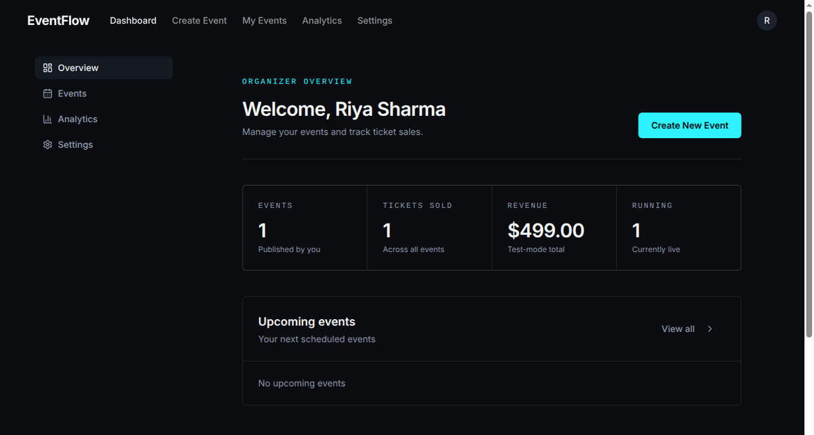
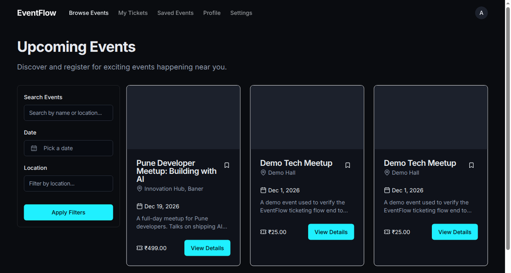
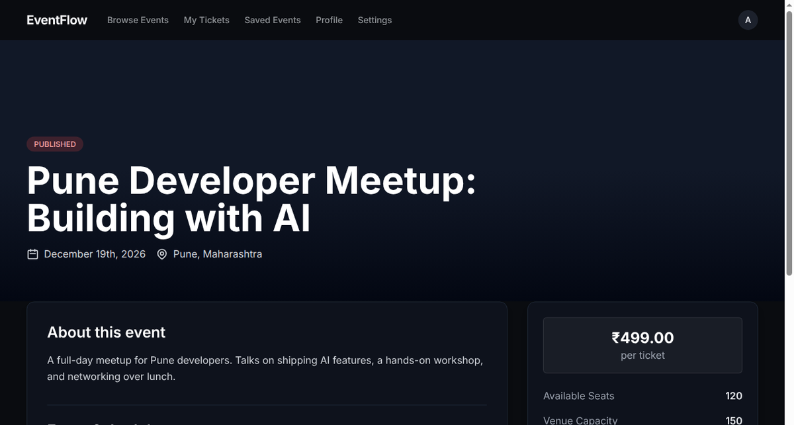
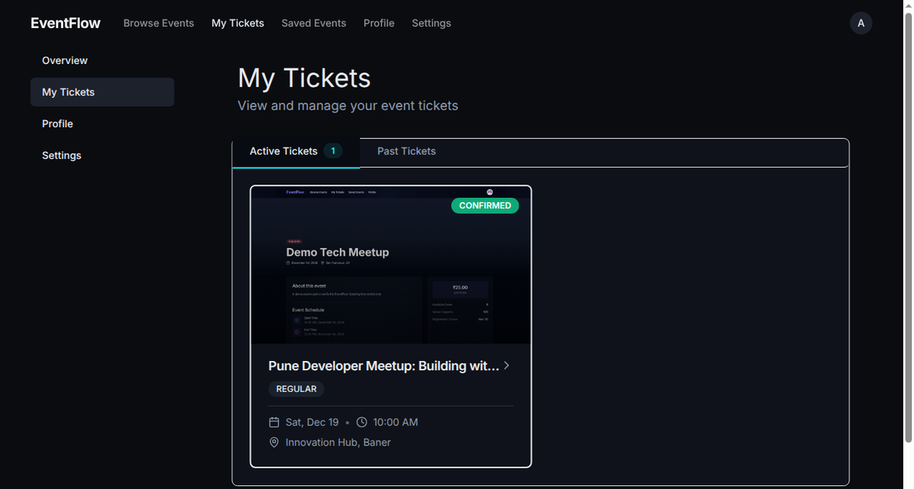

# EventFlow — Event Management & Ticketing Platform

[](https://nextjs.org/)
[](https://react.dev/)
[](https://www.typescriptlang.org/)
[](https://www.postgresql.org/)
[](https://orm.drizzle.team/)
[](https://stripe.com/)
[](LICENSE)

A full-stack event management and ticketing web app. Organizers publish events and track sales. Attendees browse events, save them, buy tickets, and view everything in their dashboard.

**Live demo:** https://eventflow.zephop.com

This is a portfolio project, built to be read as well as run. It uses a real PostgreSQL database, real authentication, and a real Stripe checkout flow in test mode. The code is structured so a student or interviewer can follow one request from the browser down to a database transaction.

---

## Table of contents

- [Screenshots](#screenshots)
- [What it does](#what-it-does)
- [Tech stack](#tech-stack)
- [Architecture](#architecture)
- [Getting started](#getting-started)
- [Environment variables](#environment-variables)
- [Project structure](#project-structure)
- [API routes](#api-routes)
- [Database schema](#database-schema)
- [Testing and CI](#testing-and-ci)
- [Deployment](#deployment)
- [What to talk about in an interview](#what-to-talk-about-in-an-interview)
- [Known limitations](#known-limitations)
- [License](#license)

---

## Screenshots

Captured from the live deployment on 22 November 2026. The full step-by-step walkthrough, with 25 screenshots of both roles and the demo checkout, is in [`DOCS/user-guide.md`](DOCS/user-guide.md). A Word version is generated with `python scripts/generate_user_guide_docx.py`.

**Organizer dashboard after a sale**



**Events listing**



**Event detail**



**Attendee tickets after demo checkout**



---

## What it does

EventFlow has two roles with separate dashboards.

**Organizers**

- Create an account and complete onboarding.
- Publish events with a date, venue, capacity, ticket price (₹), registration deadline, and description.
- Edit, publish, and delete their own events.
- See event count, ticket sales, revenue, and upcoming events in a dashboard, plus charts in Analytics.

**Attendees**

- Browse public events and filter by search, date, and location.
- Save events and see them later.
- Buy a ticket through Stripe Checkout in test mode, or through the labeled demo checkout.
- See purchased tickets in a personal dashboard and receive an email receipt.
- Sign in with email and password or with Google.

**The ticketing flow**

1. The organizer sets a ticket price on the event. The app reads that price from the database at checkout, so the client cannot set it.
2. Stripe Checkout takes a card payment in test mode.
3. On success, the webhook or success page calls one function that inserts the ticket, records the payment, and decrements the available seats inside a single database transaction. The seat update is conditional on `seats_available > 0`, so a sold-out event cannot be oversold.
4. A confirmation email goes out with the ticket number and event details.

The deployed demo runs with `DEMO_CHECKOUT=true`, which issues the same ticket through the same transaction without contacting Stripe. Clicking **Register Now** goes straight to a "Demo Registration Confirmed" page, the ticket appears in **My Tickets**, and the seat count drops by one. This was verified on the live site on 22 November 2026.

---

## Tech stack

| Layer | Technology | Why it is here |
|---|---|---|
| Framework | Next.js 15 App Router | Server components, server actions, and route handlers in one deployable app |
| UI | React 19, TypeScript, Tailwind CSS, shadcn/ui, Radix | Typed components and accessible UI primitives |
| Database | PostgreSQL 16 on Neon | Relational data with real constraints and transactions |
| ORM | Drizzle ORM | Typed schema and migrations in plain TypeScript and SQL |
| Auth | NextAuth v4 | JWT sessions, credentials provider, Google OAuth |
| Payments | Stripe Checkout | Hosted checkout and signed webhooks, test mode only |
| Email | Nodemailer over SMTP | Payment receipts |
| Storage | UploadThing | Profile and event images |
| Hosting | Vercel | The app and API in one project |
| CI | GitHub Actions | Install, lint, typecheck, and build on every pull request |

---

## Architecture

```text
Browser
  -> Vercel Edge (NextAuth middleware: session, role, onboarding)
  -> Vercel Node functions (server components, server actions, route handlers)
       -> Neon PostgreSQL (pooled connection, Drizzle, migrations as release step)
       -> Stripe (test-mode Checkout and signed webhook)
       -> Google OAuth
       -> SMTP provider (receipts)
       -> UploadThing (images)
  -> Sentry-ready structured logging and /api/health
```

Key decisions are recorded in [`DOCS/adr/`](DOCS/adr/). Current setup and release steps are in [`DOCS/deployment.md`](DOCS/deployment.md). The original pre-fix gap register is preserved in `archive/notes/DEPLOYMENT_REQUIREMENTS.md`.

---

## Getting started

### Prerequisites

- Node.js 20.9 or newer
- pnpm
- Docker (for local PostgreSQL)
- A Google Cloud OAuth client and a Stripe test account for the full flow

### Run locally

```bash
git clone https://github.com/manascb1344/EventFlow.git
cd EventFlow
pnpm install
cp .env.example .env
docker compose up -d
pnpm db:migrate
pnpm db:seed
pnpm dev
```

Open http://localhost:3000.

To test a purchase, use Stripe test card `4242 4242 4242 4242`, any future expiry, and any CVC. No real money moves.

### Common commands

| Command | What it does |
|---|---|
| `pnpm dev` | Start the development server |
| `pnpm build` | Create a production build |
| `pnpm lint` | Run ESLint |
| `pnpm typecheck` | Run the TypeScript compiler without emitting files |
| `pnpm db:generate` | Generate a migration from schema changes |
| `pnpm db:migrate` | Apply migrations |
| `pnpm db:seed` | Load sample events |
| `pnpm db:reset` | Drop all tables (development only) |

---

## Environment variables

`.env.example` lists every variable the app reads. Never commit real values.

| Group | Variables |
|---|---|
| Database | `POSTGRES_URL` |
| Auth | `NEXTAUTH_SECRET`, `NEXTAUTH_URL`, `GOOGLE_CLIENT_ID`, `GOOGLE_CLIENT_SECRET` |
| Origins | `NEXT_PUBLIC_APP_URL`, `BASE_URL` |
| Payments | `STRIPE_SECRET_KEY`, `STRIPE_WEBHOOK_SECRET` |
| Email | `SMTP_HOST`, `SMTP_PORT`, `SMTP_SECURE`, `SMTP_USER`, `SMTP_PASSWORD`, `SMTP_FROM_EMAIL` |
| Storage | `UPLOADTHING_TOKEN` |
| Demo | `DEMO_CHECKOUT` |
| Seed only | `UNSPLASH_API_KEY` |

---

## Project structure

```text
app/
  (landing)/          Public home, events listing, event detail, success
  (marketing)/        Features, pricing, about, docs, contact, changelog
  auth/               Sign-in and sign-up pages for both roles
  onboarding/          Profile completion for both roles
  dashboard/           Organizer and attendee dashboards
  api/                 NextAuth, Stripe checkout, Stripe webhook, UploadThing, health
components/            Shared navigation, footer, event cards, shadcn/ui primitives
lib/
  actions/            Shared server actions
  auth/               NextAuth configuration
  db/                 Drizzle schema, client, migrations, seed, reset
  email/              Nodemailer transport and templates
  payments/           Stripe client
  ticketing/          Atomic ticket issuance
providers/            Session provider
DOCS/                 Deployment guide, user guide, screenshots and architecture decision records
scripts/              python-docx generator for the Word user guide
archive/              Historical Selenium scripts, reports and screenshots
```

---

## API routes

| Route | Method | Purpose |
|---|---|---|
| `/api/auth/[...nextauth]` | GET, POST | NextAuth session and OAuth handlers |
| `/api/stripe` | POST | Create a Stripe Checkout session, or issue a demo ticket |
| `/api/stripe/webhook` | POST | Verify Stripe signature and issue a ticket on payment success |
| `/api/uploadthing` | GET, POST | UploadThing file router |
| `/api/health` | GET | Liveness check |

---

## Database schema

Nine tables: `organizers`, `attendees`, `events`, `tickets`, `payments`, `speakers`, `surveys`, `reports`, and `saved_events`.

Constraints worth reading:

- `saved_events` has a unique index on `(attendee_id, event_id)`.
- `events.seats_available` has a non-negative check constraint.
- Ticket number, payment intent, and transaction IDs are unique.
- The ticket issue path reserves a seat with `WHERE seats_available > 0` inside a transaction.

See [`lib/db/schema.ts`](lib/db/schema.ts) and the SQL migrations in [`lib/db/migrations/`](lib/db/migrations/).

---

## Testing and CI

```bash
pnpm lint
pnpm typecheck
pnpm build
```

GitHub Actions runs the same three commands on every pull request. Vercel builds every pull request as well.

The Python Selenium scripts, DOCX reports, screenshots and HTML reports are historical artifacts from a browser-testing exercise. They live under `archive/selenium/` and are not part of CI. See `archive/selenium/README.md` before running them.

---

## Deployment

- Vercel hosts the Next.js app at https://eventflow.zephop.com.
- Neon hosts PostgreSQL. Preview deployments get their own database branch.
- Environment variables are set in Vercel for Production and Preview.
- Migrations are applied as a release step with `pnpm deploy-migrate`, not during the build.
- Google OAuth allows both the custom domain and the Vercel domain.
- Stripe stays in test mode. The webhook is registered for the custom domain.
- See [DOCS/deployment.md](DOCS/deployment.md) for the current setup and release steps.

---

## What to talk about in an interview

- **Atomic seat reservation.** Why a read-modify-write on a seat count oversells under concurrency, and how a conditional update inside a transaction fixes it.
- **Server-side authorization.** Middleware gates routes, but pages and server actions also check the session and ownership. Client-only checks are not enough.
- **Price integrity.** The checkout price comes from the database, never from the client.
- **Webhook verification.** Signature checking, idempotency, and why the success page and the webhook share one ticket-issue function.
- **Serverless database access.** Pooled connections and why a direct Postgres connection exhausts serverless limits.
- **Migrations as a release step.** Why generating migrations during a build is wrong.
- **Honest demo data.** No invented metrics, logos, or testimonials. The demo checkout is labeled.

---

## Known limitations

- Real Stripe test payments require account activation on the Stripe account. The labeled demo checkout works without it.
- Email delivery is configured through SMTP but has not been verified end to end against a live inbox.
- Organizers cannot upload an event banner from the UI. Banners only come from seed data, and events without one show a neutral placeholder.
- Attendee sign-up asks only for email and password, so the attendee is greeted by their email prefix until they set a name in Profile.
- The organizer and attendee dashboards use separate guards. An unauthenticated organizer is currently sent to the attendee sign-in page.
- Stripe Connect payout columns exist in the schema, but there is no payout flow.

---

## License

MIT. See [LICENSE](LICENSE).
